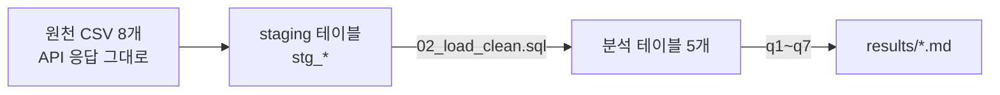
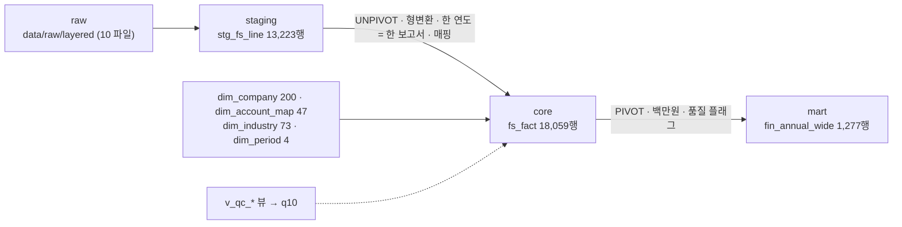

# DART x KRX 섹터 재무 분석 - SQL 포트폴리오

공시(DART)와 주가(거래소) 데이터를 5개 테이블로 적재하고, **정제부터 분석까지 SQL로만** 처리한 프로젝트입니다.
투자 실무에서 실제로 던지는 7개 질문(섹터 내 수익성 순위, 연말 밸류에이션, 턴어라운드 스크리닝 등)에 답합니다.

| 항목 | 내용 |
|---|---|
| 대상 | 1단계: 국내 상장 13개사(인터넷플랫폼 4 · IT인프라/SaaS 5 · 게임 4) 심층 · 2단계: KOSPI 시가총액 상위 200사 유니버스 |
| 데이터 | 13사: 연결 재무제표 연간 FY2020~2025 · 분기 2023~2025, 일별 주가 2023~2025, 주요사항보고서 2023~2025 · 200사: 사업보고서 2021~2025 전체 주요계정(전기·전전기 열 포함 FY2019~2025) |
| 엔진 | SQLite (3.35 이상, 3.50.4에서 실행). 2~4단계 계층 파이프라인은 DuckDB 2.0 에서도 같은 SQL 로 빌드해 결과 대조([`docs/ENGINE_PARITY.md`](docs/ENGINE_PARITY.md)) |
| 규모 | 1단계 테이블 6개 + 계층 테이블 11개(dim 4 · staging 3 · core 2 · mart 1 · etl_log), SQL 17개 파일(약 1,500줄), 분석 쿼리 15개. SQLite 와 DuckDB 에서 같은 SQL 실행 확인 |

## 결과물

| 결과물 | 위치 | 내용 |
|---|---|---|
| 분석 결과 15건 | [`results/`](results/) | 질문별 md 1개: 질문·기법 주석 + 결과 표 + 실행한 SQL 전문 |
| 계층 파이프라인(2~4단계) | [`sql/03_schema_layered.sql`](sql/03_schema_layered.sql), [`sql/04_load_layered.sql`](sql/04_load_layered.sql), [`data/dim/`](data/dim/) | raw → staging → core → mart 4계층, 보조테이블 4개, 품질점검 뷰, 전체 재무제표 API 대체 경로(account_id 매핑), 공시 이벤트 분류 |
| 증분 적재 | `python scripts/build_db.py --incremental` | 새 raw 파일만 적재하고 그 파일의 회사만 재계산. 전체 빌드와 체크섬 동일 확인 |
| 엔진 대조 | [`scripts/run_duckdb.py`](scripts/run_duckdb.py) → [`docs/ENGINE_PARITY.md`](docs/ENGINE_PARITY.md) | 같은 SQL 을 DuckDB 로 실행해 core·mart·쿼리 결과를 SQLite 와 행 단위 비교 |
| 분석 DB | `dart_sector.db` | 정제 완료된 SQLite 파일. 클론 후 바로 쿼리 가능 |
| SQL | [`sql/`](sql/) | 테이블 정의, 정제, 분석 쿼리 q1~q7 |
| 구조 설명 | [`docs/SQL_STRUCTURE.md`](docs/SQL_STRUCTURE.md) | 파이프라인·정제 단계·ERD 도식, 쿼리별 기법 표 |
| 원천 데이터 | [`data/raw/`](data/raw/) | API 응답 형태 그대로의 CSV 8개 (재현용) |
| 확장 기획 | [`docs/LARGE_SCALE_PLAN.md`](docs/LARGE_SCALE_PLAN.md), [`docs/LARGE_SCALE_DESIGN.xlsx`](docs/LARGE_SCALE_DESIGN.xlsx) | 대형화 설계와 계층별 분류 기준·보조테이블·계정 매핑 규칙 표. 1~4단계 전부 구현 (분기 → 200사 계층 → 대체 수집·증분·DuckDB → 공시 이벤트 결합) |

## 핵심 결과

**사실**은 결과 표 수치, **추론**은 해석입니다. 상세는 각 링크의 결과 파일에 있습니다.

| # | 질문 | 핵심 결과 |
|---|---|---|
| [Q1](results/q1_margin_rank_yoy.md) | 섹터 안에서 누가 가장 수익성이 좋은가 | FY2025 영업이익률 1위: 크래프톤 31.7%(게임), 더존비즈온 28.6%(IT인프라/SaaS), SOOP 26.8%(플랫폼) |
| [Q2](results/q2_yearend_valuation.md) | 2025년 말 밸류에이션은 | PER 최저 헥토이노베이션 5.7배, 최고 카카오 51.4배. ROE 최고 SOOP 20.6% |
| [Q3](results/q3_sector_share_cagr.md) | 5년간 누가 섹터 점유율을 늘렸나 | 크래프톤 게임 섹터 매출 비중 23.6% → 40.9%, NC 34.2% → 18.5% |
| [Q4](results/q4_turnaround_health.md) | 흑자·적자전환 기업과 재무건전성 | FY2025 흑자전환 NC·NHN, 적자전환 카카오게임즈. NC는 건전성 조건 충족 |
| [Q5](results/q5_price_return_vs_profit.md) | 2025년 주가는 이익을 따라갔나 | 넷마블(영업이익 +63.5%, 주가 -4.6%)과 SOOP이 '이익↑ 주가↓' 괴리 |
| [Q6](results/q6_data_quality.md) | 데이터를 믿을 수 있나 | 자산 = 부채 + 자본 78행 전부 일치. 주가 누락은 상장폐지 1사뿐 |
| [Q7](results/q7_filings_vs_price_range.md) | 공시가 많은 해에 주가도 크게 움직였나 | 주요사항보고서 71건 중 59건이 자기주식 관련. 건수와 변동폭은 뚜렷한 관계 없음 |
| [Q8](results/q8_quarter_quality.md) | 분기 데이터는 믿을 만한가 | 156행 중 누적→3개월 왕복·분기합=연간·항등식 전부 통과. 이상치 1건(카카오게임즈 2023Q4, 연중 중단영업 재분류) |
| [Q9](results/q9_quarter_trend.md) | 분기로 보면 2025년 실적 방향은 | 크래프톤 1~3분기 영업이익률 37~52% vs 4분기(도출) 0.3%, NAVER는 4개 분기 모두 YoY +10% 이상 |
| [Q10](results/q10_universe_mapping_monitor.md) | 200사로 넓히면 매핑·커버리지는 어디서 새나 | 1차 빌드 미매핑 4.7%(전부 금융업 계정 14개) → 매핑 추가 후 0%. 주요계정 API는 금융업을 2023년부터만 제공 |
| [Q11](results/q11_layered_vs_phase1_crosscheck.md) | 새 파이프라인이 1단계와 같은 숫자를 내나 | 겹치는 13사 x 연도 전부 일치. 다른 건 1단계가 보충 CSV로 채운 카카오·크래프톤 2020 매출뿐 |
| [Q12](results/q12_universe_sector_profile.md) | 업종별로 수익성·성장은 어디에 | 매출 합계 1위 전자부품·반도체(610조, 영업이익률 15.9%), 매출 CAGR 1위 조선·항공 +26.3%, 의약품 가중 영업이익률 22.2% |
| [Q13](results/q13_universe_screen.md) | 성장·수익성·건전성을 다 갖춘 곳은 | 4개 조건 전부 통과 11사: 에이피알, 삼양식품, HD현대마린엔진, 삼성바이오로직스, 이수페타시스, 셀트리온, 강원랜드, F&F, NAVER, 크래프톤, 한미반도체 |
| [Q14](results/q14_events_vs_financials.md) | 공시를 낸 회사와 안 낸 회사는 재무가 다른가 | 자기주식 공시 회사 66사의 부채비율 중앙값 77.4% vs 미공시 85사 113.1%. 자금조달 공시 회사도 78.9% vs 101.5% - 레버리지가 높은 곳이 조달 공시를 내는 건 아니다 |
| [Q15](results/q15_restructure_next_year.md) | 구조변경 공시 다음 해 매출은 | 구조변경 공시 7건의 다음 해 매출 증가율 중앙값 +4.1%, 자금조달만 16건 +9.8%, 무공시 278건 +5.7%. 표본이 작아 방향만 |

## SQL로 한 것

| 작업 | 쓴 기법 | 위치 |
|---|---|---|
| 테이블 설계 | 원천 그대로 받는 staging(`stg_*`)과 분석용 테이블 분리, PK·FK·UNIQUE·CHECK 제약 | `sql/01_schema.sql` |
| 문자열 금액 정제 | `"1,234"` / `"-"` → 정수·NULL (`CASE`, `REPLACE`, `CAST`) | `sql/02_load_clean.sql` |
| 가로 ↔ 세로 변환 | 3개년 열 → 연도별 행 (`UNION ALL`), 계정 행 → 열 (`MAX(CASE ...)` + `GROUP BY`) | `sql/02_load_clean.sql` |
| 중복 제거 | 정정공시 우선 1건 (`ROW_NUMBER() OVER (... ORDER BY rcept_no DESC)`) | `sql/02_load_clean.sql` |
| 여러 테이블 결합 | 재무·주가·주식수·공시 4계열을 `companies` 를 통해 JOIN. 결측 행은 `LEFT JOIN` 으로 유지 | q2, q5, q7 |
| 윈도우 함수 | `LAG`, `RANK`, `ROW_NUMBER`, `FIRST_VALUE`/`LAST_VALUE`, `SUM() OVER (PARTITION BY)` | q1~q5, q7, q9 |
| 분기 데이터 정제 | 분기보고서 당기·전기 열을 UNPIVOT 해 "최신 보고서 우선"으로 1건, 3개월값 → 연초누적(`SUM() OVER ... ROWS UNBOUNDED PRECEDING`), 4분기 = 연간 - 1~3분기 도출, 누적→3개월 왕복 검증(`LAG`) | `sql/02_load_clean.sql`, q8 |
| 계층 분리 (2단계) | raw CSV → `stg_fs_line`(문자열 그대로) → `fs_fact`(회사 x 연도 x 계정, 원 단위, 표준계정) → `fin_annual_wide`(와이드, 백만원). 값을 바꾸는 규칙은 core 한 곳에만 | `sql/03_schema_layered.sql`, `sql/04_load_layered.sql` |
| 사람이 관리하는 규칙의 테이블화 | 계정명 변형 → 표준 계정(`dim_account_map` 47행), 보고서코드 → 분기(`dim_period`), KSIC 코드 → 업종(`dim_industry`), 회사 마스터(`dim_company`). 코드 수정 없이 CSV 행 추가로 대응 | `data/dim/*.csv` |
| 한 연도 = 한 보고서 | 회사·연도마다 최신 접수번호 보고서 하나를 골라 모든 계정을 거기서만 가져옴. 계정별로 따로 고르면 자산·부채와 자본의 출처가 섞여 항등식이 깨짐(1차 빌드에서 2사 발견) | `sql/04_load_layered.sql` |
| 품질점검 뷰 | 미매핑 계정 집계(`v_qc_unmapped_accounts`), 회사별 커버리지·결측·항등식(`v_qc_company_coverage`) → q10 이 UNION ALL 로 한 표에 | `sql/04_load_layered.sql`, q10 |
| 파이프라인 교차검증 | 1단계 mart 와 2단계 mart 의 교집합을 JOIN, 계정별 차이를 UNPIVOT 해 0 이 아닌 행만 | q11 |
| 대체 수집 경로 (3단계) | 주요계정 API 가 안 주는 회사는 전체 재무제표 API(`stg_fs_full`)로. 같은 `fs_fact` 에 `source` 열로 들어가고, 같은 보고서가 두 소스에 있으면 주요계정 우선. 매핑은 `account_id` 가 있으면 코드로("IX. 당기순이익", "자본 총계" 같은 이름 흔들림 무시), 없으면 계정명으로 | `sql/04_load_layered.sql` |
| 연결 없으면 별도 | `v_fin_annual` 뷰: 회사·연도에 CFS 가 있으면 CFS, 없으면 OFS (은행 단독 법인은 별도만 있음). 분석 쿼리는 이 뷰만 읽음 | `sql/04_load_layered.sql` |
| 증분 적재 | `etl_log.raw_ref` 로 적재된 파일을 기억하고, 새 파일에 등장한 회사만 `incr_scope` 에 넣어 core·mart 를 그 회사분만 지우고 재계산. 전체 빌드와 체크섬 일치 | `scripts/build_db.py --incremental` |
| 엔진 이식성 | 정수 나눗셈·불리언 합산·문자열 연결·NULL 비교·32비트 정수 등 엔진이 갈리는 7가지를 피해 쓰고, DuckDB 로 같은 SQL 을 실행해 행 단위 대조 | `scripts/run_duckdb.py` |
| 공시 이벤트 분류 (4단계) | 주요사항보고서 제목을 CASE 로 자기주식·자금조달·구조변경·기타로 분류, 정정공시 플래그. 재무 mart 와 JOIN 해 그룹별 중앙값 비교(q14), LEAD 로 이듬해 실적(q15) | `sql/04_load_layered.sql`, q14, q15 |
| 품질 점검 | 회계 항등식, 결측 탐지(`LEFT JOIN ... IS NULL`), 거래일 수 비교를 `UNION ALL` 로 한 표에 | q6 |



2단계는 같은 흐름을 4계층으로 나누고 보조테이블을 붙인 것입니다.



정제 단계별 예시와 ERD는 [`docs/SQL_STRUCTURE.md`](docs/SQL_STRUCTURE.md)에 있습니다.

## 데이터

| 테이블 | 원천 | 행 수 | 키 |
|---|---|---|---|
| `companies` | 직접 작성 (섹터 분류는 작성자 기준) | 13 | corp_code (PK), stock_code (UQ) |
| `financials_annual` | DART 다중회사 주요계정 API, 사업보고서 FY2025·FY2022 | 78 (13사 x 6년) | corp_code + fiscal_year + fs_div |
| `financials_quarter` | DART 주요계정 API, 분기보고서 1Q·반기·3Q 2023~2025 (9건) | 156 (13사 x 12분기, 4분기 39행은 도출) | corp_code + fiscal_year + quarter + fs_div |
| `financials_quarter` | DART 주요계정 API, 분기보고서 1Q·반기·3Q 2023~2025 (9건) | 156 (13사 x 12분기, 4분기 39행은 도출) | corp_code + fiscal_year + quarter + fs_div |
| `prices_daily` | yfinance (KOSPI .KS / KOSDAQ .KQ) | 8,760 (12사 x 730일) | stock_code + trade_date |
| `shares_outstanding` | KRX 상장종목 목록 + 수기 보충 1건 | 13 | stock_code |
| `filings` | DART 공시목록 API, 주요사항보고서 2023~2025 | 86 (정정 15건 포함) | rcept_no |

2단계 (KOSPI 시가총액 상위 200사, 보통주, 2026-11-18 기준, 스팩·리츠 제외)

| 계층 | 테이블 | 원천 | 행 수 | 키 |
|---|---|---|---|---|
| dim | `dim_company` | FinanceDataReader KOSPI 목록(시총) + DART 기업개황(업종코드·결산월) | 200 | corp_code (PK), stock_code (UQ) |
| dim | `dim_account_map` | 직접 작성. 1차 빌드 미매핑 목록을 보고 금융업 계정 14개 추가 | 47 | map_id |
| dim | `dim_industry` | KSIC 10차 중분류 2자리 → 대분류·중분류명·금융 여부 | 73 | ksic2 |
| dim | `dim_period` | 보고서코드 → 분기, 당기·전기 열의 뜻 | 4 | reprt_code |
| staging | `stg_fs_line` | DART 다중회사 주요계정, 사업보고서 2021~2025 x 100사 배치 2개 | 13,223 | (없음, 원문) |
| core | `fs_fact` | staging 두 소스를 UNPIVOT·형변환·매핑 (`source` 열) | 18,981 | corp_code + fiscal_year + fs_div + sj_div + account_nm |
| mart | `fin_annual_wide` | core 를 PIVOT, 백만원, 품질 플래그. 분석은 `v_fin_annual`(CFS 우선, 없으면 OFS) 로 | 1,286 | corp_code + fiscal_year + fs_div |
| staging | `stg_fs_full` | DART 전체 재무제표 API(별도), 주요계정 API 가 안 주는 3사 x 사업보고서 2025 | 486 | (없음, 원문) |
| staging | `stg_filings_u` | DART 공시목록 API, 200사 주요사항보고서 2023~2025 | 778 | (없음, 원문) |
| core | `filings_universe` | 공시 1건 1행 + 유형 분류(자기주식 510 · 자금조달 158 · 구조변경 88 · 기타 22) | 778 | rcept_no |
| log | `etl_log` | raw 파일 단위 적재 기록 (증분 적재의 기준) | 14 | log_id |

```
companies 1 ──< financials_annual     (corp_code)
companies 1 ──< financials_quarter    (corp_code)
companies 1 ──< financials_quarter    (corp_code)
companies 1 ──< prices_daily          (stock_code)
companies 1 ──1 shares_outstanding    (stock_code)
companies 1 ──< filings               (corp_code)
```

`companies` 가 DART 키(`corp_code`)와 거래소 키(`stock_code`)를 모두 가지고 있어서, 공시 계열 테이블과 주가 계열 테이블을 잇는 역할을 합니다.

## 질문별 상세

<details>
<summary>Q1~Q7 사실 / 계산 / 추론 전체 보기</summary>

### Q1. 섹터 내 영업이익률 순위와 YoY 성장 - [q1](results/q1_margin_rank_yoy.md)
기법: JOIN, LAG, RANK() OVER (PARTITION BY sector)
- 사실: FY2025 섹터별 영업이익률 1위는 더존비즈온 28.6%, 크래프톤 31.7%, SOOP 26.8%
- 사실: 게임 섹터는 크래프톤(22.8%)·넷마블(6.4%) 외 2사 매출 역성장, 카카오게임즈 -25.9%
- 추론: IT인프라/SaaS는 삼성SDS를 빼면 4사 매출 성장률이 +10.9~18.9%로 비슷하고, 차이는 마진에서 난다

### Q2. 연말 시가총액·PER·PBR - [q2](results/q2_yearend_valuation.md)
기법: ROW_NUMBER로 연도별 마지막 거래일 추출, 3테이블 JOIN, LEFT JOIN으로 결측 유지
- 계산: 시가총액 = 2025-12-30 종가 x 주식수, PER = 시가총액 / FY2025 순이익, PBR = 시가총액 / 자본총계
- 사실: PER 최저는 헥토이노베이션 5.7배(PBR 0.6배), 최고는 카카오 51.4배. ROE 최고는 SOOP 20.6%
- 주의: 주식수는 수집 시점(2026-11) 기준이라 과거 연도 시가총액은 근사치. 더존비즈온은 2026-07 상장폐지로 주가가 없어 NULL (LEFT JOIN으로 행은 유지)

### Q3. 섹터 합산 비중 변화와 5년 CAGR (FY2020 → FY2025) - [q3](results/q3_sector_share_cagr.md)
기법: SUM() OVER (PARTITION BY), POWER()를 이용한 CAGR
- 사실: 크래프톤은 게임 섹터 매출 비중이 23.6% → 40.9%(+17.3%p), 섹터 영업이익의 74.1% 차지
- 사실: NC는 같은 기간 게임 섹터 매출 비중 34.2% → 18.5%(-15.7%p), 매출 CAGR -9.0%로 유일한 큰 폭 역성장
- 사실: NAVER는 플랫폼 섹터 매출 비중 47.3% → 52.1%, 매출 CAGR 17.8%, 영업이익 비중 69.1%
- 계산: CAGR = (FY2025 매출 / FY2020 매출)^(1/5) - 1
- 추론: 두 섹터 모두 1위 기업으로의 이익 집중이 매출 집중보다 훨씬 강하다 - 규모의 경제보다 사업 믹스 차이로 보임

### Q4. 흑자전환·적자전환 스크리닝 + 재무건전성 - [q4](results/q4_turnaround_health.md)
기법: LAG + CASE 상태 라벨, 다중 조건 플래그
- 사실: FY2025 흑자전환은 NC(-109.2 → 16.1십억), NHN(-32.6 → 132.4십억). 적자전환은 카카오게임즈
- 사실: NC는 부채비율 28.6%, 유동비율 353.5%로 건전성 플래그 충족
- 추론: NC는 영업이익(16십억)보다 순이익(347십억)이 훨씬 커서 영업외 이익이 실적을 만든 해 - 턴어라운드 품질은 따로 봐야 한다

### Q5. 2025년 주가 수익률 vs 영업이익 변화 - [q5](results/q5_price_return_vs_profit.md)
기법: FIRST_VALUE / LAST_VALUE, WINDOW 절, 일별 → 연간 집계 후 재무 JOIN
- 사실: 주가 수익률 상위는 가비아 +87.5%, NHN +65.2%, 카카오 +60.5%. 하위는 SOOP -24.8%, 크래프톤 -22.3%
- 사실: '이익↑ 주가↓' 괴리는 넷마블(영업이익 +63.5%, 주가 -4.6%)과 SOOP(+10.0%, -24.8%)
- 추론: 13개 표본 1개 연도라 통계적 결론은 불가. 괴리 종목을 추가 조사 대상으로 뽑는 1차 필터 용도

### Q6. 데이터 품질 점검 - [q6](results/q6_data_quality.md)
기법: UNION ALL로 점검 묶기, LEFT JOIN + IS NULL, HAVING
- 사실: 자산 = 부채 + 자본 항등식은 78행(13사 x 6년) 전부 ±2백만원 안에서 일치
- 사실: 더존비즈온 주가 누락 1건(상장폐지), 나머지 12사는 거래일 730일로 동일

### Q7. 주요사항보고서 건수 vs 주가 변동폭 - [q7](results/q7_filings_vs_price_range.md)
기법: 회사 x 연도 뼈대(CROSS JOIN) + LEFT JOIN으로 공시 0건 연도 유지, CASE 조건부 집계로 공시 유형 분류, RANK() OVER (PARTITION BY 연도)
- 사실: 정정공시를 뺀 주요사항보고서 71건 중 59건이 자기주식 취득·처분·신탁 관련
- 사실: 연도별 변동폭 1위는 NC(2023, 124.2%), 케이아이엔엑스(2024, 101.5%), 가비아(2025, 124.5%) - 그 해 주요사항보고서는 각각 0건, 0건, 1건
- 사실: 3년간 공시가 가장 많은 카카오(8·7·3건)는 변동폭 순위 5·3·2위
- 계산: 변동폭 = (연중 최고 종가 - 최저 종가) / 최저 종가
- 추론: 주요사항보고서 대부분이 자기주식 관련 정례 공시라 건수 자체는 주가 변동의 설명 변수가 되기 어렵다. 자금조달(사채·증자)·구조변경(합병·분할·감자)만 따로 보는 편이 의미 있음

### Q8. 분기 데이터 품질 점검 - [q8](results/q8_quarter_quality.md)
기법: SUM() OVER (ROWS UNBOUNDED PRECEDING) 로 누적, LAG 차분으로 되돌려 왕복 일치 확인, UNION ALL 점검 묶기
- 사실: 156행 전부 누적→3개월 왕복 일치, 분기합 = 연간, 자산 = 부채 + 자본 통과. 손익 결측 0건
- 사실: 4분기 도출값 이상치 1건 - 카카오게임즈 2023Q4 매출 -20.7십억. 3분기 보고서부터 매각 자회사를 중단영업으로 분리해 1·2분기(포함)와 3분기·연간(제외) 기준이 섞임
- 계산: 4분기 3개월 = 사업보고서 연간 - 1~3분기 합. 분기값은 당해 보고서 당기 열과 이듬해 보고서 전기 열 중 접수번호가 최신인 것
- 추론: 연중 재분류는 주요계정 API 로는 해소되지 않는다. 사업보고서 주석의 분기별 정보가 필요

### Q9. 2025년 분기 추세 - [q9](results/q9_quarter_trend.md)
기법: LAG(…, 4) 로 전년 같은 분기 비교(계절성), LAG(…, 1) 로 QoQ, 연간 테이블 JOIN 으로 분기·연간 이익률 병기
- 사실: NAVER 는 4개 분기 모두 매출 YoY +10.3~15.6%, 영업이익률 17.9~19.1% 로 고르다
- 사실: 크래프톤은 1~3분기 영업이익률 37.2~52.3% 인데 4분기(도출)는 2.4십억, 0.3%. 연간 보고서 기준으로 4분기에 비용이 집중됐다는 뜻이며 원인은 이 데이터로는 알 수 없다
- 사실: 카카오게임즈는 4개 분기 모두 영업적자, 매출 YoY -21.7~-31.1%
- 추론: 연간 1위(q1)인 크래프톤도 분기로 쪼개면 변동이 크다 - 분기 데이터가 연간 순위를 보완하는 이유

### Q10. 200사 유니버스 매핑·커버리지 모니터 - [q10](results/q10_universe_mapping_monitor.md)
기법: 품질점검 뷰 2개 위에 UNION ALL, 조건부 집계, HAVING
- 사실: 1차 빌드 fs_fact 18,140행 중 미매핑 849행(4.7%), 전부 금융업 계정 14개(예수부채·보험계약부채·순이자손익 등). `dim_account_map` 에 14행 추가 후 0% ([1차 빌드 결과 보존](docs/qc_snapshots/q10_first_run_before_mapping_20261118.md))
- 사실: 매출액이 없는 회사 17사는 전부 금융업(은행·보험·증권) - 매출액 대신 순이자손익·보험수익 체계. `is_financial` 로 EXPECTED 처리
- 사실: 주요계정 API 는 금융업을 2023년 사업보고서부터만 제공. 카카오뱅크·케이뱅크·맥쿼리인프라·KB발해인프라·에코프로머티는 전 연도 없음
- 사실: 항등식 실패는 SK텔레콤 2022 1건(차이 -30백만원, 같은 보고서 안의 값) - API 원값의 반올림으로 보이며 수정하지 않음
- 추론: 대형화에서 가장 큰 결측 원인은 파싱이 아니라 "API 가 그 회사를 안 준다"는 것. 전체 재무제표 API 로 대체 수집하는 경로가 3단계 과제

### Q11. 두 파이프라인 교차검증 - [q11](results/q11_layered_vs_phase1_crosscheck.md)
기법: 1단계 mart(financials_annual) 와 2단계 mart(fin_annual_wide) 를 JOIN, 계정 4개를 UNPIVOT, NULL 안전 비교(IS NOT)
- 사실: 유니버스에 모두 있는 9사 x FY2020~2025 x 4계정에서 다른 값 0건
- 사실: 차이로 남는 건 카카오·크래프톤 2020 매출(1단계는 전체 재무제표 보충값, 2단계는 주요계정 API 에 없어 NULL)과 유니버스 밖 4사(SOOP·가비아·케이아이엔엑스·헥토이노베이션·카카오게임즈·더존비즈온)
- 추론: 같은 원천에 같은 규칙을 적용하면 두 구현이 같은 숫자를 내야 한다 - 이 검증이 통과해야 2단계 파이프라인으로 1단계를 대체할 수 있다

### Q12. 업종별 수익성·성장 프로필 - [q12](results/q12_universe_sector_profile.md)
기법: dim_company x dim_industry x fin_annual_wide JOIN, 업종별 중앙값(ROW_NUMBER + COUNT OVER), POWER 로 4년 CAGR, HAVING 으로 3사 이상
- 사실: FY2025 매출 합계 1위 전자부품·반도체(14사, 610조, 가중 영업이익률 15.9%, 중앙값 5.0%) - SK하이닉스 한 곳이 가중치를 끌어올림
- 사실: 매출 CAGR(21→25) 1위 조선·항공 +26.3%(7사, 영업이익률 11.1%), 2위 포털·플랫폼 +18.9%, 3위 의약품 +13.7%(가중 영업이익률 22.2%)
- 사실: 금융업 49사(은행·지주 35, 보험 8, 증권 6)는 매출 개념이 달라 수익성 지표에서 제외
- 추론: 가중 평균과 중앙값의 차이가 큰 업종(반도체·의약품)은 1~2개사가 업종을 대표하므로 업종 평균을 벤치마크로 쓰면 안 된다

### Q13. 성장 + 수익성 + 건전성 스크리닝 - [q13](results/q13_universe_screen.md)
기법: 조건부 집계로 4개 연도를 한 행에, 복합 조건 플래그 합산, RANK 전체·업종 내
- 조건: 매출 CAGR(21→25) ≥ 10%, FY2025 영업이익률 ≥ 10%, 부채비율 ≤ 100%, 2023~2025 3년 연속 영업흑자 (금융업 제외)
- 사실: 4개 전부 통과 11사. CAGR 상위 에이피알 +55.8%(영업이익률 23.9%), 삼양식품 +38.3%, HD현대마린엔진 +30.8%, 삼성바이오로직스 +30.6%(영업이익률 45.4%)
- 사실: 2021 매출이 없는 신규 상장사(시프트업·달바글로벌 등)는 CAGR 이 NULL 이라 빠진다 - 누락이 아니라 조건 미충족
- 추론: 1차 필터일 뿐이며, 다음 단계는 q5 처럼 주가와 붙여 괴리를 보는 것

### Q14. 공시 이벤트 x 재무 상태 - [q14](results/q14_events_vs_financials.md)
기법: 공시 유형별 조건부 집계 → 회사 플래그, 재무 mart JOIN, 지표 3개를 세로로 펼쳐 한 번의 창 함수 중앙값, UNION ALL
- 사실: 2023~2025 주요사항보고서 778건(정정 229건 제외 549건) 중 자기주식 457건, 자금조달 54건, 구조변경 18건, 기타 20건
- 사실: 비금융 151사 중 자기주식 공시 회사 66사의 FY2025 부채비율 중앙값 77.4%, 영업이익률 7.8% / 미공시 85사 113.1%, 6.6%
- 사실: 자금조달 공시 회사 25사 부채비율 중앙값 78.9% vs 미공시 101.5%. 구조변경 10사 77.6% vs 106.5%
- 추론: 주요사항보고서를 내는 회사는 재무가 좋은 쪽으로 쏠린다 - 자금조달 공시가 "급한 회사"의 신호라는 통념과 다르다. 다만 유니버스가 시총 상위라 생존 편향이 있다

### Q15. 구조변경 공시 다음 해 실적 - [q15](results/q15_restructure_next_year.md)
기법: 회사 x 연도 뼈대에 공시 건수 LEFT JOIN, LEAD 로 다음 해 매출·영업이익, 그룹별 중앙값
- 사실: 구조변경 공시가 있던 회사·연도 7건의 다음 해 매출 증가율 중앙값 +4.1%, 자금조달만 16건 +9.8%, 무공시 278건 +5.7%
- 사실: 셀트리온 2023 합병 → 2024 매출 +63.4%(영업이익 -24.5%), 에코프로머티 2023 타법인 취득 → 2024 매출 -68.5%
- 추론: 7건으로는 방향도 말하기 어렵다. 공시 본문(합병 비율·대상 규모)을 붙여야 분석이 되며, 그것이 공시 원문 파싱 과제

</details>

## 실행 방법

```bash
pip install -r requirements.txt
python scripts/build_db.py         # CSV -> dart_sector.db (기존 DB 삭제 후 재생성, 1단계 + 계층 파이프라인)
python scripts/run_queries.py      # sql/q*.sql 실행 -> results/*.md
```

새 raw 파일을 `data/raw/layered*/` 에 넣은 뒤에는 전체 재빌드 대신 증분 적재로 그 회사만 다시 계산할 수 있습니다.

```bash
python scripts/build_db.py --incremental
```

DuckDB 로 같은 SQL 을 실행해 SQLite 결과와 대조하려면 (`pip install duckdb` 필요):

```bash
python scripts/run_duckdb.py       # dart_sector.duckdb 생성, docs/ENGINE_PARITY.md 갱신
```

DB만 열어 보려면 빌드 없이 `sqlite3 dart_sector.db` 로 바로 쿼리할 수 있습니다.

데이터 재수집(선택, 네트워크 필요):
- 주가·주식수: `python scripts/fetch_prices.py`
- 재무: OpenDART API 키를 환경변수 `DART_API_KEY` 로 두고 `python scripts/fetch_dart.py 2019` 처럼 실행한 뒤 `scripts/build_db.py` 의 `CSV_TO_STAGING` 에 파일을 등록

## 데이터 처리 메모와 한계

- FY2022 사업보고서의 주요계정 API에는 카카오·크래프톤·카카오게임즈의 매출액 행이 없습니다(손익계산서 계정명이 '영업수익'). 같은 보고서의 전체 재무제표 API '영업수익' 값을 `dart_revenue_supplement_fy2022.csv` 에 원형 그대로 옮겨 적재했습니다. `fetch_dart.py` 로 다른 연도를 받을 때도 같은 결측이 생길 수 있습니다.
- 카카오 FY2022 값은 2024-03 정정 사업보고서(20240320000393) 기준입니다.
- 주식수는 수집 시점(2026-11-18) 기준이라 과거 연도 시가총액은 근사치입니다.
- 더존비즈온은 2026-07 상장폐지로 주가가 없습니다. 주식수는 사업보고서 자본금 / 액면가로 추정해 보충했지만(31,477,993주), 주가가 없어 Q2 밸류에이션은 NULL로 남습니다.
- 분기 데이터는 주요계정 API 스냅샷의 당기 열(3개월값)과 전기 열(전년 동기 3개월, 최신 기준 재표시)을 함께 써서 "최신 보고서 우선"으로 뽑았습니다. 4분기는 분기보고서가 없어 연간 - 1~3분기로 도출했고 `is_derived = 1` 로 표시합니다. 연중에 재분류가 생긴 해(카카오게임즈 2023)는 4분기가 왜곡됩니다.
- 2023년 분기보고서 주요계정 API 에도 매출액 행이 없는 회사(카카오·크래프톤·카카오게임즈·헥토이노베이션)가 있어 전체 재무제표 API 로 보충했습니다(`dart_key_accounts_q_supplement.csv`). 카카오게임즈 3Q24 영업이익·순이익도 같은 방식이며, 순이익은 계속영업 + 중단영업 합계입니다.
- 섹터 분류는 작성자 기준입니다(삼성SDS를 IT인프라/SaaS에 넣은 것은 논쟁 여지가 있음).
- 13개사 표본이라 통계적 결론은 내지 않습니다. 결과는 추가 조사 대상을 고르는 1차 필터 용도입니다.
- 2단계 유니버스는 KOSPI200 공식 구성종목이 아니라 FinanceDataReader 의 KOSPI 시가총액 상위 200 보통주(2026-11-18)입니다. pykrx 의 지수 구성종목 조회는 KRX 로그인이 필요해 쓰지 않았습니다.
- 주요계정 API(fnlttMultiAcnt)는 금융업을 2023년 사업보고서부터만 주고, 은행 단독 법인·인프라펀드·일부 신규 상장사는 아예 주지 않습니다. 3단계에서 전체 재무제표 API(fnlttSinglAcntAll)로 대체 수집해 카카오뱅크·케이뱅크·에코프로머티는 별도 기준으로 2023~2025 를 채웠습니다. 맥쿼리인프라·KB발해인프라(펀드)는 두 API 모두 없고, 금융업 2021~2022 도 두 API 모두 없습니다(KB금융·삼성생명으로 확인).
- 공시 이벤트 분류는 제목 키워드 기준이라 거칠고, 공시 본문(금액·대상)은 읽지 않았습니다. 200사 공시 목록 778건은 보조 에이전트가 옮겨 적은 것으로, 1단계에서 받아 둔 6개사 56건과 전부 일치하는 것만 확인했습니다.
- 유니버스에 주가가 없어 q7(공시 vs 주가 변동폭)의 200사 확장은 하지 않았습니다.
- 업종은 DART 기업개황 업종코드(KSIC) 앞 2자리입니다. 지주회사는 '전문서비스(71)' 로, 화장품은 '화학(20)' 으로 묶이는 등 사업 실질과 다를 수 있습니다.
- 2단계 항등식 실패 1건(SK텔레콤 2022, -30백만원)은 같은 보고서 안의 API 값이라 그대로 두었습니다.
- corp_code 200건과 기업개황 200건은 보조 에이전트가 API 응답을 옮겨 적은 것입니다. corp_code 는 주요계정 응답의 stock_code 와 200건 전부 대조했고, 업종코드·결산월은 대조하지 않았습니다.
- PostgreSQL 실행은 검증하지 않았습니다.

## 폴더 구조

```
dart-sql-portfolio/
├── README.md
├── CLAUDE.md                 # Claude Code 작업 규칙·진행 상황
├── docs/
│   ├── PLAN.md               # 기획 문서
│   ├── SQL_STRUCTURE.md      # SQL 구현 구조 도식
│   ├── LARGE_SCALE_PLAN.md   # 대형 데이터 SQL 전처리 확장 기획
│   ├── LARGE_SCALE_DESIGN.xlsx  # 계층별 분류 기준·보조테이블·계정 매핑·품질점검 표
│   ├── ENGINE_PARITY.md      # SQLite vs DuckDB 대조 결과 (run_duckdb.py 가 생성)
│   └── qc_snapshots/         # 품질점검 1차 결과 보존 (매핑 추가 전)
├── requirements.txt / .env.example / .gitignore
├── dart_sector.db            # 빌드 결과 (재생성 가능)
├── data/dim/                 # 사람이 관리하는 보조테이블 (2단계)
│   ├── dim_company.csv               # 200사 마스터 (업종코드·결산월·시총)
│   ├── dim_account_map.csv           # 계정명 변형 → 표준 계정, 부호, 유형
│   ├── dim_industry.csv              # KSIC 2자리 → 대분류·중분류·금융 여부
│   └── dim_period.csv                # 보고서코드 → 분기
├── data/raw/
│   ├── layered/                      # 2단계 원천: 사업보고서 2021~2025 x 배치 2 = 10 파일
│   ├── layered_full/                 # 3단계: 전체 재무제표 API (주요계정 API 가 안 주는 3사, 별도)
│   ├── layered_filings/              # 4단계: 200사 주요사항보고서 목록 2023~2025
│   ├── companies.csv                       # 회사 마스터 (섹터 분류)
│   ├── dart_key_accounts_fy2025.csv        # DART 주요계정 원형 FY2023~2025
│   ├── dart_key_accounts_fy2022.csv        # DART 주요계정 원형 FY2020~2022
│   ├── dart_key_accounts_fy2023/2024.csv   # FY2023·FY2024 사업보고서 (정정 반영용)
│   ├── dart_key_accounts_q_fy*_*.csv       # 분기보고서 주요계정 9건 (1Q 11013 / 반기 11012 / 3Q 11014)
│   ├── dart_key_accounts_q_supplement.csv  # 분기 결측 보충 (전체 재무제표 API)
│   ├── dart_revenue_supplement_fy2022.csv  # 매출액 행이 빠진 3사 보충
│   ├── filings.csv                         # 주요사항보고서 목록 2023~2025
│   ├── prices_daily.csv                    # 일별 주가
│   ├── shares_outstanding.csv              # KRX 주식수
│   └── shares_manual.csv                   # 주식수 수기 보충 (근거 포함)
├── scripts/
│   ├── fetch_dart.py         # OpenDART API (DART_API_KEY 필요)
│   ├── fetch_prices.py       # yfinance + KRX 목록
│   ├── build_db.py           # CSV -> SQLite (--incremental 지원)
│   ├── run_duckdb.py         # 같은 SQL 을 DuckDB 로 빌드해 SQLite 와 대조
│   └── run_queries.py        # q*.sql -> results/*.md
├── sql/
│   ├── 01_schema.sql         # staging / 분석용 테이블
│   ├── 02_load_clean.sql     # 정제 (UNPIVOT·형변환·중복제거·PIVOT)
│   ├── 03_schema_layered.sql # 2단계 계층 테이블·보조테이블
│   ├── 04_load_layered.sql   # 2단계 staging → core → mart, 품질점검 뷰
│   └── q1 ~ q15 *.sql        # 분석 쿼리 (질문·기법 주석 포함)
└── results/                  # 쿼리별 결과 표 + SQL
```

## 출처

- 재무제표: 금융감독원 DART 다중회사 주요계정 (fnlttMultiAcnt), 사업보고서·분기보고서. 숫자별 접수번호는 `financials_annual.source_rcept_no`, `financials_quarter.source_rcept_no`. 결측 보충은 전체 재무제표 (fnlttSinglAcntAll)
- 공시 목록: 금융감독원 DART 공시검색 (list.json, pblntf_ty=B), 최종보고서 기준
- 주가: Yahoo Finance (yfinance)
- 주식수: KRX 상장종목 목록 (FinanceDataReader), 2026-11-18 기준
- 더존비즈온 상장폐지(2026-07-15): EQT파트너스 공개매수 후 주식교환, 언론 보도 기준
- 200사 유니버스: FinanceDataReader KOSPI 종목 목록(시가총액), 2026-11-18. 업종코드·결산월: DART 기업개황 API. 업종 분류명: KSIC 10차
- 200사 공시 목록: DART 공시검색 API (list.json, pblntf_ty=B), 2023-01-01 ~ 2025-12-31. 대체 재무: DART 단일회사 전체 재무제표 API (fnlttSinglAcntAll, 별도)
