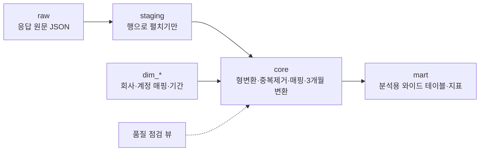

# 기획 - DART 대형 데이터 SQL 전처리

작성일: 2026-11-18 · 상태: 기획 (1단계 분기 데이터는 구현 완료, 2~4단계 구현 전) · 분류 기준 표: `LARGE_SCALE_DESIGN.xlsx`

현재 프로젝트는 13개사 x 사업보고서 2건(FY2020~2025) 규모입니다. 이 문서는 같은 방식(정제·분석은 SQL로)을 전 상장사·분기·전체 계정 수준으로 키울 때의 설계입니다.

## 1. 목표와 규모

| 항목 | 현재 | 목표 |
|---|---|---|
| 회사 | 13 | 전 상장사 약 2,700 |
| 기간 | 연간 6년 | 분기, 10년 |
| 계정 | 주요계정 8개 | 전체 재무제표 계정 (BS·IS·CIS·CF) |
| 원천 행 수 | 수백 | 수천만 (추정: 회사 x 40개 분기 x 보고서당 수백 계정) |

## 2. 규모가 커지면 생기는 문제

| 문제 | 내용 | 대응 |
|---|---|---|
| API 호출량 | OpenDART 일일 호출 한도가 있음 | 회사 x 연도 x 보고서 단위로 쪼개 받고, 호출 로그로 이어받기 |
| 계정명 불일치 | 회사·연도마다 계정명이 다름 (이 프로젝트의 FY2022 매출 누락 사례: '매출액' 대신 '영업수익') | `account_nm` 대신 `account_id`(IFRS 표준코드) 기준 + 매핑 테이블 |
| 분기 누적값 | 분기 손익이 누적으로 옴 | 3개월값으로 바꾸는 차분을 SQL로, 같은 계정 안에서만 |
| 정정공시 | 같은 기간 보고서가 여러 건 | 최신 접수번호 1건 우선 (`ROW_NUMBER`) |
| 현금흐름 부호 | 회사마다 유출을 양수로 적는 등 부호 관행이 다름 | 절댓값(abs)으로 맞추지 않고, 계정별 부호 규칙을 매핑 테이블에 둠 |
| 금융업 | 은행·보험은 재무제표 구조가 다름 | 별도 매핑 세트, 1차 범위에서는 제외 |

## 3. 계층 설계



| 계층 | 테이블 | 하는 일 |
|---|---|---|
| raw | `raw_fs_json` (응답 원문, 호출 파라미터, 수집시각) | 받은 그대로 저장. 다시 받지 않고 재처리 가능 |
| staging | `stg_fs_line` (회사, 연도, 보고서코드, fs_div, sj_div, account_id, account_nm, 당기·전기 금액 문자열, rcept_no) | JSON을 행으로 펼치기만 함 |
| core | `fs_fact` (회사, 기간, 표준계정, 금액, 연결/별도, 3개월/누적, 출처 rcept_no) | 형변환, 중복제거, 계정 매핑, 3개월 변환 |
| mart | `fin_annual`, `fin_quarter`, `ratios` | 분석용 와이드 테이블과 지표 |

보조 테이블

| 테이블 | 내용 |
|---|---|
| `dim_company` | 회사 마스터. 상장폐지일, 종목코드 변경 이력 |
| `dim_account_map` | account_id·계정명 변형 → 표준 계정, 부호 규칙. 사람이 관리 |
| `dim_period` | 보고서코드(11013 1분기 / 11012 반기 / 11014 3분기 / 11011 사업) → 분기 |
| `etl_log` | 호출 단위 성공·실패, 행 수, 수집시각 |

## 4. 핵심 SQL 처리

### 4-1. 형변환 + 표준 계정 매핑

```sql
-- 매핑 안 된 계정은 표준계정 NULL 로 남겨 따로 점검한다
SELECT s.corp_code, p.fiscal_year, p.quarter, s.fs_div,
       m.std_account,
       CASE WHEN TRIM(s.thstrm_amount) IN ('', '-') THEN NULL
            ELSE CAST(REPLACE(TRIM(s.thstrm_amount), ',', '') AS BIGINT) END
         * COALESCE(m.sign, 1)                                     AS amount_krw,
       s.rcept_no
FROM stg_fs_line s
JOIN dim_period p      ON p.bsns_year = s.bsns_year AND p.reprt_code = s.reprt_code
LEFT JOIN dim_account_map m
       ON m.account_id = s.account_id
       OR (m.account_id IS NULL AND m.account_nm = s.account_nm);
```

### 4-2. 정정공시 우선

```sql
ROW_NUMBER() OVER (
    PARTITION BY corp_code, fiscal_year, quarter, fs_div, std_account
    ORDER BY rcept_no DESC
) = 1
```

### 4-3. 분기 누적 → 3개월

```sql
-- 손익 계정만. 1분기는 누적 그대로, 이후는 직전 분기 누적을 뺀다 (같은 계정 안에서만)
SELECT corp_code, fiscal_year, quarter, std_account,
       cum_amount - COALESCE(
           LAG(cum_amount) OVER (PARTITION BY corp_code, fs_div, fiscal_year, std_account
                                 ORDER BY quarter), 0)                AS q_amount
FROM fs_fact_cum
WHERE statement IN ('IS', 'CIS', 'CF');
```

4분기 3개월값 = 사업보고서 연간값 - 3분기 누적. 3분기 누적이 없으면 NULL 로 두고 점검 대상에 올린다.

### 4-4. 증분 적재

- 새 `rcept_no` 만 staging 에 넣고, 영향받는 (회사, 기간)만 core 를 다시 계산한다
- SQLite·DuckDB·PostgreSQL 공통: `INSERT ... ON CONFLICT (키) DO UPDATE`

### 4-5. 품질 점검 뷰

| 점검 | 조건 |
|---|---|
| 회계 항등식 | 자산 = 부채 + 자본 (반올림 허용 오차) |
| 분기 합계 | 3개월값 4개 합 = 연간값 |
| 결측 | 매출·자산총계 NULL |
| 이상치 | 전년 대비 10배 이상 변동 |
| 미매핑 | 표준계정 NULL 인 행 수, 회사별 비율 |

점검에 걸린 행은 mart 로 넘기지 않고 플래그만 단다.

## 5. 엔진 선택

| 엔진 | 적합한 경우 | 비고 |
|---|---|---|
| SQLite | 수백만 행까지, 혼자 쓰는 파일 | 현재 프로젝트. 대용량 집계·동시 쓰기에 약함 |
| **DuckDB (권장)** | 수천만 행, 혼자 분석 | 파일 하나. JSON·Parquet 을 SQL 로 바로 읽음 (`read_json_auto`, `read_parquet`). raw 를 Parquet 으로 두고 staging 부터 SQL 만으로 처리 가능 |
| PostgreSQL | 여러 사람이 함께 쓰거나 서비스와 연결 | 연도 기준 파티션 |

## 6. 단계 계획

| 단계 | 범위 | 완료 기준 |
|---|---|---|
| 1 (완료 11-18) | 현재 13사에 분기 데이터 추가 | `financials_quarter` 156행, 누적↔3개월 왕복·분기합 = 연간·항등식 통과 (q8). 배운 것: 분기 주요계정 API 는 3개월값으로 오고 전기 열이 전년 동기 재표시값이라 '최신 보고서 우선'을 분기에도 적용해야 함. 연중 재분류(카카오게임즈 2023)는 API 로 해소 불가 |
| 2 | KOSPI200 약 200사 x 5년 | 계정 매핑 테이블 구축, 미매핑 비율 모니터링 |
| 3 | 전 상장사 x 10년, DuckDB 이전 | 증분 적재, 호출 로그, 이어받기 |
| 4 | 공시 원문(지분·CB 등) 결합 | 재무 x 이벤트 분석 (q7 확장) |

## 7. 확인 필요

- OpenDART 일일 호출 한도의 정확한 숫자 - 시작 전에 공식 안내 확인
- 금융업 재무제표 매핑 범위
- API 키 신규 발급 (환경변수 `DART_API_KEY` 로만 사용, 코드·CSV·문서에 원문 금지)
- 위 행 수·단계 범위는 추정이며 실측 전
