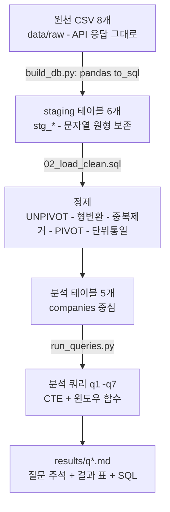
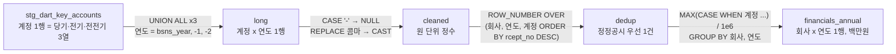
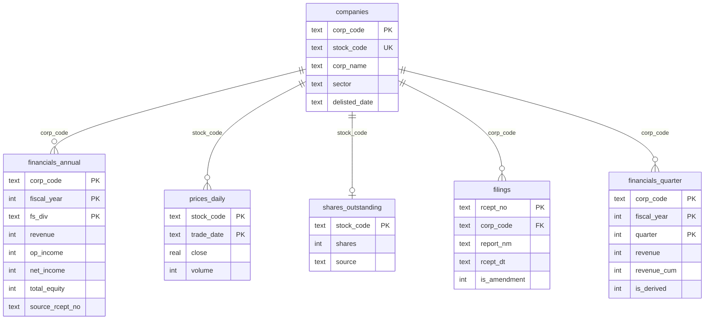
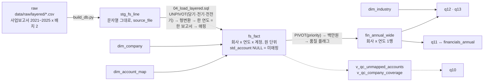
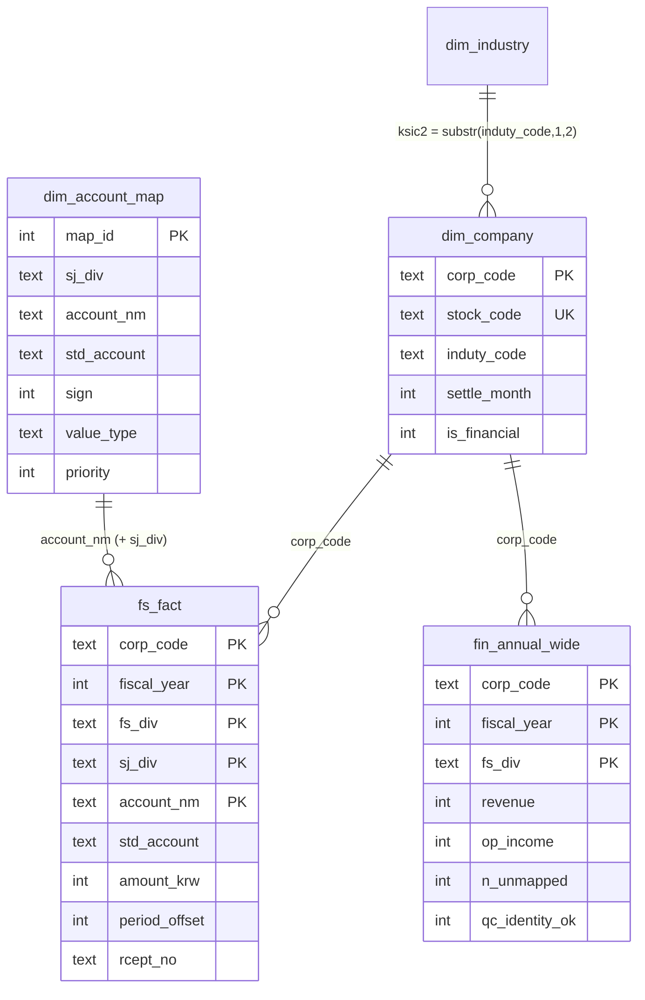

# SQL 구현 구조

README 의 질문별 결과가 어떤 SQL 구조에서 나오는지 정리한 문서입니다. GitHub 에서 mermaid 도식으로 보입니다.

## 1. 파이프라인

원칙: Python 은 CSV 를 문자열 그대로 옮기고 결과를 md 로 쓰는 일만 한다. 숫자를 바꾸는 모든 처리(콤마 제거, 연도 펼치기, 중복 제거, 단위 변환)는 `sql/02_load_clean.sql` 한 곳에 있다.

## 2. 재무 데이터 정제 (02_load_clean.sql)

| 단계 | 하는 일 | 쓰인 SQL |
|---|---|---|
| UNPIVOT | 사업보고서 1건의 3개년 열을 연도별 행으로 | `UNION ALL`, 연도 산술 |
| 형변환 | `"1,234"` / `"-1,234"` / `"-"` → 정수 또는 NULL | `CASE`, `TRIM`, `REPLACE`, `CAST` |
| 중복제거 | 같은 회사·연도·계정이 여러 보고서에 있으면 최신 접수번호 1건 | `ROW_NUMBER() OVER (PARTITION BY ... ORDER BY rcept_no DESC)` |
| PIVOT | 계정(행) → 컬럼, 회사 x 연도 1행 | `MAX(CASE WHEN ...)`, `GROUP BY` |
| 단위 | 원 → 백만원 | `/ 1000000` |

분기(`financials_quarter`)는 같은 패턴에 두 가지가 더해진다. (a) 분기보고서의 당기 열(그 해 3개월)과 전기 열(전년 같은 분기 3개월, 최신 기준 재표시)을 둘 다 행으로 펼친 뒤 접수번호 최신 1건을 고른다 - 손익 계정만이며 재무상태표 전기 열은 전년 말 잔액이라 제외. (b) 4분기는 보고서가 없으므로 `financials_annual` - 1~3분기 합으로 도출하고 `is_derived = 1` 을 단다. 연초누적은 `SUM() OVER (... ROWS BETWEEN UNBOUNDED PRECEDING AND CURRENT ROW)`.

같은 파일에서 주가는 `ROW_NUMBER` 로 중복 거래일 제거, 주식수는 `NOT EXISTS` 로 KRX 목록에 없는 종목만 수기 값 보충, 공시는 `SUBSTR` 로 날짜 형식 통일과 정정공시 플래그(`LIKE '[%'`)를 붙인다.

## 3. 분석 테이블 관계

`companies` 가 두 개의 키(DART `corp_code`, 거래소 `stock_code`)를 모두 들고 있어서 DART 계열 테이블과 거래소 계열 테이블을 잇는 다리 역할을 한다.

## 4. 쿼리별 기법

| 쿼리 | 질문 | JOIN 한 테이블 | 핵심 기법 |
|---|---|---|---|
| q1 | 섹터 내 영업이익률 순위, YoY | financials, companies | `LAG`, `RANK() OVER (PARTITION BY sector)` |
| q2 | 연말 시가총액·PER·PBR | financials, companies, prices, shares | `ROW_NUMBER` 로 연말 거래일, `LEFT JOIN` 결측 유지 |
| q3 | 섹터 비중 변화, 5년 CAGR | financials, companies | `SUM() OVER (PARTITION BY)`, `POWER` |
| q4 | 흑자·적자전환 + 건전성 | financials, companies | `LAG` + `CASE` 상태 라벨, 복합 조건 플래그 |
| q5 | 주가 수익률 vs 이익 변화 | prices, financials, companies | `FIRST_VALUE`/`LAST_VALUE`, `WINDOW` 절 |
| q6 | 데이터 품질 점검 | financials, prices, companies | `UNION ALL` 점검 묶기, `LEFT JOIN ... IS NULL` |
| q7 | 주요사항보고서 건수 vs 주가 변동폭 | filings, prices, companies | `CROSS JOIN` 뼈대 + `LEFT JOIN`, `CASE` 조건부 집계, `RANK` |
| q8 | 분기 데이터 품질 점검 | financials_quarter, financials_annual, companies | `SUM() OVER (ROWS UNBOUNDED PRECEDING)` 누적, `LAG` 차분 왕복, `UNION ALL` |
| q9 | 2025년 분기 추세 | financials_quarter, financials_annual, companies | `LAG(…, 4)` 전년 동기, `LAG(…, 1)` QoQ |
| q10 | 200사 매핑·커버리지 모니터 | v_qc_unmapped_accounts, v_qc_company_coverage | 뷰 위 `UNION ALL`, 조건부 집계 |
| q11 | 1단계 vs 2단계 교차검증 | financials_annual, fin_annual_wide, companies | `JOIN` + `UNION ALL` UNPIVOT, `IS NOT` |
| q12 | 업종별 수익성·성장 | dim_company, dim_industry, fin_annual_wide | 윈도우 중앙값(`ROW_NUMBER`+`COUNT OVER`), `POWER` CAGR, `HAVING` |
| q13 | 성장·수익성·건전성 스크리닝 | dim_company, dim_industry, v_fin_annual | 조건부 집계, 복합 플래그, `RANK() OVER (PARTITION BY)` |
| q14 | 공시 이벤트 x 재무 | filings_universe, v_fin_annual, dim_industry | 유형 플래그, 지표 세로 펼침 + 창 함수 중앙값, `UNION ALL` |
| q15 | 공시 → 이듬해 실적 | filings_universe, v_fin_annual | `LEAD`, 뼈대 `LEFT JOIN`, 그룹 중앙값 |

## 5. 2단계 계층 파이프라인 (KOSPI 시총 상위 200사)

1단계와 다른 점 세 가지. (1) 계정 매핑이 SQL 의 `CASE WHEN` 이 아니라 `dim_account_map` 테이블이라, 새 계정명은 CSV 에 행을 추가하고 재빌드하면 된다. (2) core(`fs_fact`)는 세로(long) 형태로 모든 계정을 보존하고 미매핑도 `std_account NULL` 로 남겨, 무엇이 빠졌는지 뷰로 센다. (3) 한 회사·연도의 숫자는 보고서 하나에서만 가져온다. 계정마다 최신 보고서를 따로 고르면 자산·부채와 자본의 출처가 달라져 항등식이 깨진다(1차 빌드에서 2사 발견).

## 6. 3~4단계에서 더해진 것

- **두 번째 staging** `stg_fs_full`(전체 재무제표 API, account_id 포함)과 세 번째 `stg_filings_u`(공시 목록). core 로 갈 때 `src` CTE 에서 두 재무 소스를 UNION 하고 `source_rank` 로 주요계정 API 를 우선한다.
- **매핑 2단**: `account_id` 가 있으면 코드로(`ifrs-full_Equity` 는 "자본총계"·"자본 총계" 를 모두 잡음), 없으면 (sj_div, 계정명). `mapped` CTE 의 ROW_NUMBER 가 코드 매핑을 앞세운다.
- **`v_fin_annual` 뷰**: 회사·연도에 연결(CFS)이 있으면 연결, 없으면 별도(OFS). q10 이후 분석 쿼리는 전부 이 뷰를 읽는다.
- **`incr_scope`**: build_db.py 가 매 실행마다 채우는 회사 목록. 04 SQL 의 core·mart·filings 단계가 전부 이 표와 JOIN 하므로, 전체 빌드와 증분 적재가 같은 SQL 을 쓴다.
- **공시 유형 분류**: `filings_universe.event_type` 은 04 의 CASE 로 제목 키워드를 분류한다. 규칙이 바뀌면 재빌드로 재분류된다.
- **엔진 이식성**: `scripts/run_duckdb.py` 가 03·04·q10~q15 를 DuckDB 로 실행해 SQLite 와 대조한다. 피한 문법은 `docs/ENGINE_PARITY.md`.
